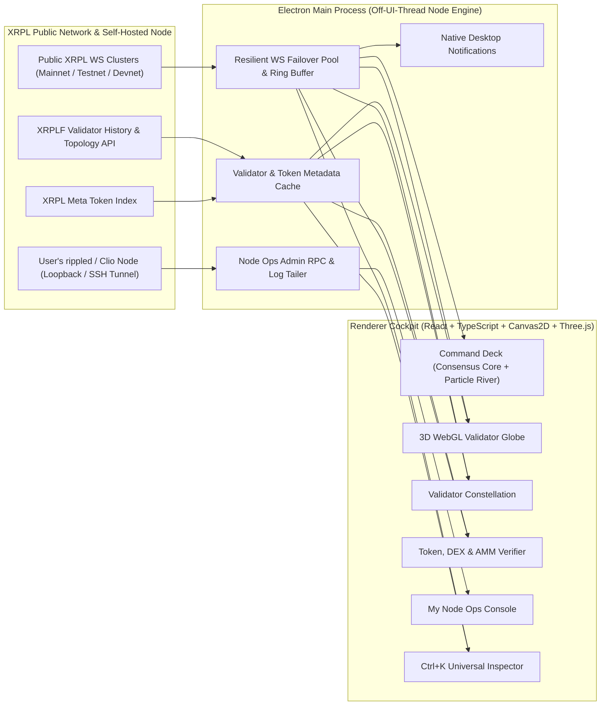

<div align="center">


# XRPL Command Center

**Real-Time Cross-Platform XRP Ledger Telemetry, 3D Consensus Visualizer, Token/AMM Explorer & Self-Hosted `rippled` / Clio Node Ops Console**

[](CHANGELOG.md)
[](#cross-platform-packaging)
[](#security--non-custodial-guardrails)
[](LICENSE)

</div>

---

## Overview

**XRPL Command Center** is a cross-platform desktop application (Linux `.AppImage`, Windows `.exe`, macOS `.dmg`) engineered to make the live **XRP Ledger** visually tangible in real time—while giving node operators a safe, loopback-first cockpit to monitor and manage their own `rippled` or Clio infrastructure.

Watch transactions flow across live processing lanes, observe validators converge toward the **80% UNL supermajority** every ~3.5 seconds, orbit a live **3D WebGL Validator Globe**, audit on-ledger token issuer security flags (Blackhole, GlobalFreeze, NoFreeze, Clawback) plus DEX/AMM liquidity, and administer your own node without ever exposing admin ports to the public internet.

---

## Core Modules

| Module | What You See & Control |
| :--- | :--- |
| **Command Deck** | 60fps HTML5 Canvas **Live Consensus Core** (`OPEN → ESTABLISH → 80% QUORUM → VALIDATED`), 6-lane **Real-Time Transaction Particle River** (`Payment`, `IOU/MPT`, `DEX`, `AMM`, `NFT`, `Trust/Escrow`), whale shockwaves, scrolling **Validated Ledger Chain**, and click-to-inspect decoded transaction tape. |
| **3D Holographic Globe** | Interactive **Three.js WebGL2** validator & peer topology globe with drag-to-orbit, zoom, and live geodesic arcs pulsing on consensus & transaction activity. |
| **Validator Constellation** | Live XRPLF Validator History Service (`data.xrplf.org`) metrics, UNL filters, 1h / 24h / 30d agreement scores, `rippled` version breakdown, and real-time green pulse indicators correlated to WebSocket `validationReceived` events. |
| **Tokens, DEX & AMM Explorer** | Searchable global XRPL token index (`s1.xrplmeta.org`) + live-stream token discovery + **authoritative on-ledger verification** (`account_info`, `gateway_balances`, `book_offers`, `amm_info`) for 160-bit hex currencies (e.g., `RLUSD`, `SOLO`, `CORE`), issuer risk flags, live bid/ask depth, and AMM pool reserves. |
| **My Node Ops (`rippled` / Clio)** | Connect to your local (`http://127.0.0.1:5005`) or SSH-tunneled node to inspect sync state, complete ledgers, peers (`inbound`/`outbound`/latency/sanity), pending & enabled Amendments (`feature`), state accounting, local `debug.log` tailing, 1-click **"Stream Live Visuals From My Node"**, and confirmation-gated Admin RPCs (`connect`, `log_level`, `can_delete`, `stop`). |
| **Universal Inspector & Watchlist** | Press `Ctrl+K` / `Cmd+K` from anywhere to jump to an `r...` address, 64-char transaction hash, or ledger number. Watch accounts or tokens and receive native OS desktop notifications. |

---

## System Architecture



---

## Quick Start

### Option 1: Launch a Packaged Release (`v0.0.1-alpha`)

Download the package for your operating system from the **Releases** page:

- **Linux (`.AppImage`):**
  ```bash
  chmod +x XRPL-Command-Center-0.0.1-alpha-linux-x86_64.AppImage
  ./XRPL-Command-Center-0.0.1-alpha-linux-x86_64.AppImage
  ```
  > **Ubuntu / Debian tip:** If AppArmor user-namespace restrictions or missing FUSE2 prevent direct launch, run with `--appimage-extract-and-run --no-sandbox`.
- **Windows (`.exe`):** Run `XRPL-Command-Center-0.0.1-alpha-win-x64-nsis.exe` (installer) or the `portable.exe` standalone binary.
- **macOS (`.dmg`):** Open the `arm64` (Apple Silicon) or `x64` (Intel) `.dmg` and drag **XRPL Command Center** to Applications.

### Option 2: Run From Source (Development)

**Prerequisites:** Node.js `>=18.19` (Node 20 LTS recommended) and `npm`.

```bash
npm install
npm run dev
```

### Verification & Tests

```bash
npm run typecheck   # Strict TS checks for both renderer & Electron main/preload
npm test            # Vitest XRPL protocol, BigInt drops, hex currency & flag suite
npm run build       # Production Vite bundle + esbuild Electron main/preload
```

---

## Managing Your Own `rippled` / Clio Node

Open **My Node Ops** in the left navigation rail:

1. **Local Node (Same Machine):**
   - Admin RPC URL: `http://127.0.0.1:5005`
   - Optional WebSocket Stream: `ws://127.0.0.1:6006` (click **Stream Live Visuals From My Node** to drive all animations directly off your own node!)
   - Local Log Path: `/var/log/rippled/debug.log`
2. **Remote VPS / Dedicated Server (Secure SSH Tunnel):**
   Never expose `rippled` admin port `5005` to the public internet. Forward it over SSH instead:
   ```bash
   ssh -N -L 5005:127.0.0.1:5005 -L 6006:127.0.0.1:6006 user@your-xrpl-node
   ```
   Then leave the app pointed at `http://127.0.0.1:5005` and click **Poll Node** (or toggle **Auto-Poll 5s**).
3. **Confirmation-Gated Admin Controls:**
   - All telemetry polling runs **read-only by default**.
   - Mutating commands (`connect`, `log_level`, `can_delete`, `stop`) require explicitly toggling **Unlock Admin Actions** and approving a per-command confirmation modal displaying the exact JSON-RPC payload.

---

## Cross-Platform Packaging

Build native desktop artifacts locally or automatically via [`.github/workflows/build.yml`](.github/workflows/build.yml):

```bash
npm run dist:linux   # -> release/XRPL-Command-Center-0.0.1-alpha-linux-x86_64.AppImage
npm run dist:win     # -> release/XRPL-Command-Center-0.0.1-alpha-win-x64-nsis.exe (+ portable)
npm run dist:mac     # -> release/XRPL-Command-Center-0.0.1-alpha-mac-{arm64,x64}.dmg
```

---

## Keyboard Shortcuts & Performance

| Control | Action |
| :--- | :--- |
| `Ctrl+K` / `Cmd+K` | Open Universal Command Palette (inspect address, tx hash, ledger, or switch views) |
| `Esc` | Close Command Palette or Inspector Drawer |
| Top Bar **Pause** | Freeze live animations while background telemetry & watchlist alerts keep tracking |
| Top Bar **Sparkles** | Toggle **Reduced Motion** mode for low-power laptops |

---

## Security & Non-Custodial Guardrails

- **Zero Private Key Custody:** `v0.0.1-alpha` is strictly non-custodial and read-only for wallet/ledger state—no secret seeds, mnemonics, or validator secret tokens are ever requested, stored, or logged.
- **Process Isolation:** Electron runs with `contextIsolation: true`, `nodeIntegration: false`, and renderer `sandbox: true` behind a strictly typed `contextBridge` API (`electron/preload.ts`).
- **Admin Command Allowlist:** Only explicitly allowlisted `rippled` admin RPC methods can be invoked from **My Node Ops**.

---

## Roadmap

- [x] **`v0.0.1-alpha` Core:** Cross-platform Electron shell (`.AppImage`, `.exe`, `.dmg`), live WebSocket failover pool, 60fps Consensus Core & Transaction Particle River, 3D Validator Globe, Validator Constellation, Token/DEX/AMM On-Ledger Verifier, Self-Hosted Node Ops & Log Tailer, `Ctrl+K` Inspector, Watchlist Alerts.
- [ ] **Next:** Cross-platform **One-Click Docker Node Launcher** (spin up Mainnet/Testnet/Devnet `rippled` containers from inside the app), **Visual `rippled.cfg` & `validators.txt` Diff Editor**, persistent SQLite history cache, and interactive AMM pool depth charts.

---

## License

Licensed under the [MIT License](LICENSE).
