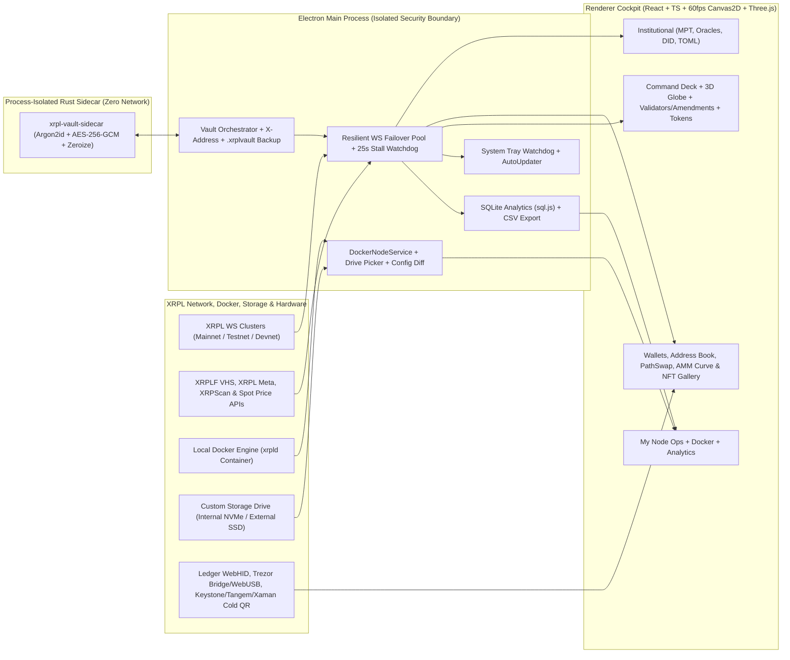

<div align="center">


# XRPL Command Center

**Real-Time Cross-Platform XRP Ledger Telemetry, 3D Consensus Globe, Encrypted Multi-Wallet & Pro DeFi Studio, Institutional Primitives (`MPT`/`Oracle`/`DID`), 1-Click Docker Node Manager & SQLite Analytics**

[](CHANGELOG.md)
[](#cross-platform-packaging)
[](#security--vault-architecture)
[](LICENSE)

</div>

---

## Overview

**XRPL Command Center** is a cross-platform desktop application (Linux `.AppImage`, Windows `.exe`, macOS `.dmg`) engineered to make the live **XRP Ledger** visually tangible in real time—combining a 60fps consensus & transaction visualization engine, an encrypted multi-wallet & hardware/multi-sig DeFi studio, a Pro DEX pathfinding & AMM curve terminal, institutional `MPT`/`Oracle`/`DID` tools, a 1-click Docker `rippled` node manager with `rippled.cfg` diff studio, and embedded SQLite analytics with CSV export.

---

## Core Modules

| Module | What You See & Control |
| :--- | :--- |
| **Command Deck** | 60fps delta-time HTML5 Canvas **Live Consensus Core** (`OPEN → ESTABLISH → 80% QUORUM → VALIDATED`), 6-lane **Transaction Particle River**, **Whale Radar** (with optional WebAudio synth chime), scrolling **Validated Ledger Chain**, live **XRP/USD HUD Ticker**, toggleable **Live FPS / Latency / Heap Perf HUD**, **Saved Custom Node Endpoint Profiles**, and click-to-inspect live transaction tape with human-readable contact labels. |
| **3D Holographic Globe** | Lazy-loaded interactive **Three.js WebGL2** validator & peer topology globe with drag-to-orbit, zoom, and live geodesic arcs pulsing on consensus & transaction activity. |
| **Validator Constellation** | Live XRPLF Validator History Service (`data.xrplf.org`) metrics, UNL filters, 1h / 24h / 30d agreement scores, `rippled` version breakdown, live `validationReceived` vote pulses, and **XRPL Amendment Voting Radar** (80% activation progress). |
| **Tokens, DEX & AMM Explorer** | Global XRPL token index (`s1.xrplmeta.org`) + live-stream discovery + **authoritative on-ledger verification** (`account_info`, `gateway_balances`, `book_offers`, `amm_info`), issuer risk flags (`Blackholed`, `GlobalFreeze`, `NoFreeze`, `Clawback`), and **60fps CLOB Depth Wall + AMM `x·y=k` Curve Canvas**. |
| **Wallets & Pro DeFi Studio** | Process-isolated **Rust Argon2id + AES-256-GCM + Zeroize Vault**, 1-click encrypted **`.xrplvault` Backup/Restore**, **Offline Printable Cold Recovery Sheet**, **Multi-Wallet Combined Net Worth (XRP + USD)**, **Open-SDK Hardware & Cold Wallet Hub** (**Ledger WebHID USB**, **Trezor Suite Bridge / WebUSB**, **Keystone 3 Pro**, **Tangem**, **D'CENT / Ellipal**, **Xaman**), **Smart Address Book & Exchange Destination-Tag Guard**, **X-Address decode**, live **USD Portfolio & Reserve Meter**, searchable **Tx History + UTF-8 Memo Decoder**, **Visual NFT Gallery**, **Air-Gapped QR**, **Native Multi-Sign**, **Smart Pathfinding Swap**, `OfferCreate`/`Cancel`, `AMMCreate`/`AMMVote`/`Deposit`/`Withdraw`, Escrows, Checks, and **1-Click Testnet Playground**. |
| **Institutional Studio** | Issue **Multi-Purpose Tokens (`MPTokenIssuanceCreate`, `MPTokenAuthorize`)**, manage regulated **`Clawback` (`XLS-39`)**, generate & lint **`xrp-ledger.toml`** with 1-click `AccountSet` domain linking, query & publish **XLS-47 Price Oracles (`get_aggregate_price` / `OracleSet`)**, and resolve/anchor **XLS-40 W3C DIDs (`DIDSet`)**. |
| **My Node Ops & Docker** | **1-Click Cross-Platform Docker `xrpld` Launcher** (Mainnet/Testnet/Devnet, loopback-only admin `127.0.0.1:5005`), **Custom Storage Drive & Folder Picker** (store multi-GB/TB `NuDB`/`RocksDB` ledger history on any internal NVMe or external SSD with live free-space monitoring), **Visual `rippled.cfg` & `validators.txt` Diff Studio** with timestamped `.bak` auto-backups, SSH-tunneled admin telemetry, and local `debug.log` tailer. |
| **Analytics, Tray & Updater** | Embedded **WebAssembly SQLite (`command-center.sqlite`)** recording ledger throughput & tracked wallet transaction journals, **1-click CSV accounting export**, **OS System Tray Mode**, **30s Background Node Watchdog**, and `electron-updater` release checks. |

---

## System Architecture



---

## Quick Start

### Option 1: Launch a Packaged Release (`v0.1.2-beta`)

Download the package for your operating system from the **Releases** page:

- **Linux (`.AppImage`):**
  ```bash
  chmod +x XRPL-Command-Center-0.1.2-beta-linux-x86_64.AppImage
  ./XRPL-Command-Center-0.1.2-beta-linux-x86_64.AppImage
  ```
  > **Ubuntu / Debian tip:** If AppArmor user-namespace restrictions or missing FUSE2 prevent direct launch, run with `--appimage-extract-and-run --no-sandbox`. On first AppImage launch, the desktop dock icon is automatically registered in `~/.local/share/icons` and `~/.local/share/applications`.
- **Windows (`.exe`):** Run `XRPL-Command-Center-0.1.2-beta-win-x64-setup.exe` (installer) or `XRPL-Command-Center-0.1.2-beta-win-x64-portable.exe` (standalone portable binary).
- **macOS (`.dmg`):** Open `XRPL-Command-Center-0.1.2-beta-mac-arm64.dmg` (Apple Silicon) and drag **XRPL Command Center** to Applications.

### Option 2: Run From Source (Development)

**Prerequisites:** Node.js `>=18.19` (Node 20 LTS recommended), `npm`, and Rust (`cargo` / `rustc`) for compiling the native vault sidecar.

```bash
npm install
npm run build:rust
npm run dev
```

### Verification & Tests

```bash
cargo test --manifest-path rust-vault/Cargo.toml  # Rust Argon2id + ed25519/secp256k1 unit tests
npm run typecheck                                 # Strict TS checks for renderer & Electron
npm test                                          # 24 Vitest tests across 6 suites
npm run build                                     # Vite + esbuild + staged Rust sidecar
```

---

## Managing Your Own `rippled` / Clio Node

Open **My Node Ops** in the left navigation rail:

1. **Choose a Storage Drive / Folder:** In **1-Click Docker Node**, click **Browse Drive / Folder…** to pick any fast internal NVMe, secondary hard drive, or external SSD for your `NuDB` / `RocksDB` ledger database. Free disk space is checked live (`fs.statfs`) with low-space warnings (`< 30 GB`).
2. **1-Click Local Docker Node:** Pick Network (`Mainnet` / `Testnet` / `Devnet`), Hardware Sizing (`16 GB` / `32 GB` / `64 GB+`), and Backend (`NuDB` / `RocksDB`), then click **Provision & Launch**. Admin RPC (`127.0.0.1:5005`) and WS (`127.0.0.1:6006`) are bound strictly to loopback.
3. **Visual `rippled.cfg` Diff Studio:** Edit `rippled.cfg` and `validators.txt` with live red/green unified line diffs and automatic timestamped `.bak` backups before saving.
4. **Remote VPS (Secure SSH Tunnel):**
   ```bash
   ssh -N -L 5005:127.0.0.1:5005 -L 6006:127.0.0.1:6006 user@your-xrpl-node
   ```
   Leave the app pointed at `http://127.0.0.1:5005`, click **Poll Node**, or enable the **30s Background Node Watchdog** under **Analytics & Tray**.

---

## Cross-Platform Packaging

```bash
npm run dist:linux   # -> release/XRPL-Command-Center-0.1.2-beta-linux-x86_64.AppImage
npm run dist:win     # -> release/XRPL-Command-Center-0.1.2-beta-win-x64-{setup,portable}.exe
npm run dist:mac     # -> release/XRPL-Command-Center-0.1.2-beta-mac-arm64.dmg
```

---

## Keyboard Shortcuts & Performance

| Control | Action |
| :--- | :--- |
| `Ctrl+K` / `Cmd+K` | Open Universal Command Palette (inspect address, tx hash, ledger, or switch modules) |
| `Esc` | Close Command Palette, Signing Modal, Quick-Start, or Inspector Drawer |
| Top Bar **?** | Re-open the Quick-Start Guide & 1-Click Testnet Playground anytime |
| Top Bar **Volume** | Toggle optional subtle WebAudio synth ping for Whale Radar & Watchlist hits |
| Top Bar **Gauge** | Toggle live **FPS / tx/s / WS Latency / JS Heap MB** Performance HUD |
| Top Bar **Pause** | Freeze live animations while background telemetry, SQLite logging & alerts keep running |
| Top Bar **Sparkles** | Toggle **Reduced Motion** mode for low-power laptops |

- **Cold-Boot & Binary Size Optimization:** All 7 secondary decks (`3D Globe`, `Validators`, `Tokens`, `Wallets`, `Institutional`, `Node Ops`, `Analytics`) are code-split via `React.lazy()` so startup only parses the Command Deck (~71% less startup JS), `dist-electron/main.js` is minified with `esbuild`, duplicate bundled `node_modules` are pruned from `app.asar`, and installers use `compression: maximum` (`~85 MB` Linux AppImage).

---

## Security & Vault Architecture

- **Process-Isolated Rust Cryptographic Vault (`rust-vault/xrpl-vault-sidecar`):** Secret seeds are encrypted at rest in `userData/wallet-vault-rust.enc.json` (`0600` permissions) using **Argon2id** (`64 MiB, 3 iterations`) + **AES-256-GCM**. Decrypted keys live exclusively inside the separate native Rust process in `Zeroizing` buffers that deterministically wipe RAM to `0x00` on lock, timeout, or exit—private keys never enter Node.js/V8 memory during transaction signing (`ed25519-dalek` & RFC-6979 low-S `k256`).
- **1-Click Encrypted `.xrplvault` Backups & Offline Paper Recovery Sheet:** Export and restore portable encrypted backups (Argon2id + AES-256-GCM ciphertext only—plaintext seeds are never written to disk) with automatic `.bak` snapshots before restore, or print an offline Cold Recovery Sheet with wallet address QR and blank handwritten seed lines.
- **Exchange Destination-Tag Guard & X-Address Support:** Automatically warns before sending to known exchanges (Coinbase, Kraken, Bitstamp, Binance, Uphold, KuCoin, Crypto.com) or saved tagged contacts without a Destination Tag, and natively decodes XRPL X-Addresses.
- **Hardened Electron Session:** Strict CSP, `contextIsolation: true`, `nodeIntegration: false`, renderer `sandbox: true`, top-level navigation lock (`will-navigate`), and permission denial (permitting only Ledger USB `0x2c97` over WebHID and Trezor `0x1209`/`0x534c` over WebUSB).
- **Open-SDK Hardware & Air-Gapped Signing:** Connect **Ledger** directly over WebHID (`0x2c97`), detect **Trezor** via local Trezor Suite Bridge (`127.0.0.1:21325`) or WebUSB (`0x1209`/`0x534c`), pair **Keystone 3 Pro / Tangem / D'CENT / Ellipal / Xaman** cold wallets, export unsigned canonical `tx_json` QR codes, or combine M-of-N `SignerListSet` partial multi-signatures.
- **Human-in-the-Loop Pre-Flight Gate:** Every transaction runs live `Sequence`, `Fee` cap, unfunded-reserve, and `lsfRequireDestTag` checks before presenting a network-aware (`MAINNET` high-visibility alert vs. `TESTNET`/`DEVNET`) confirmation modal.

---

## License

Licensed under the [MIT License](LICENSE).
